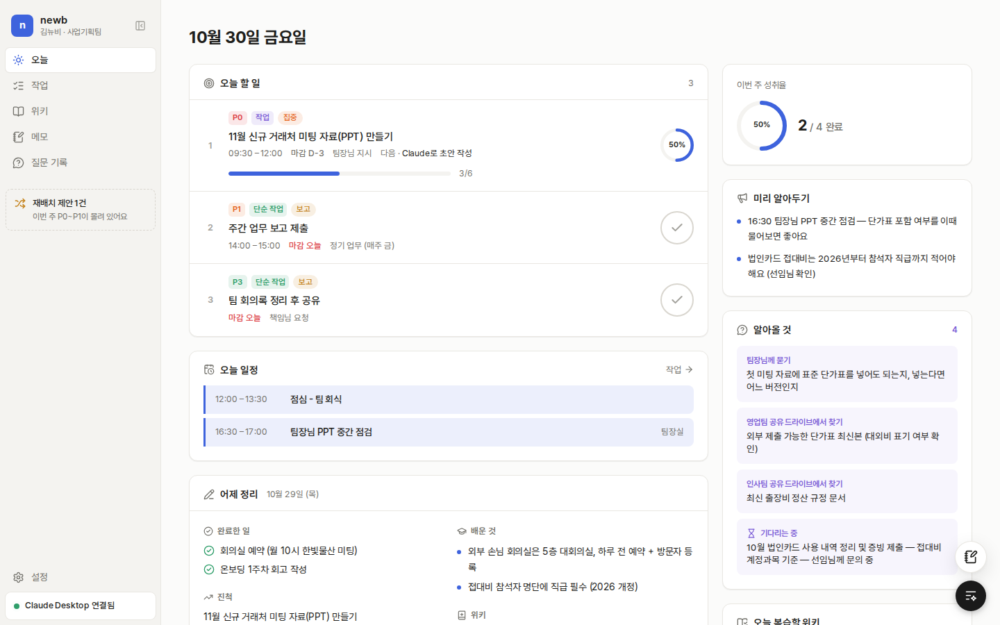
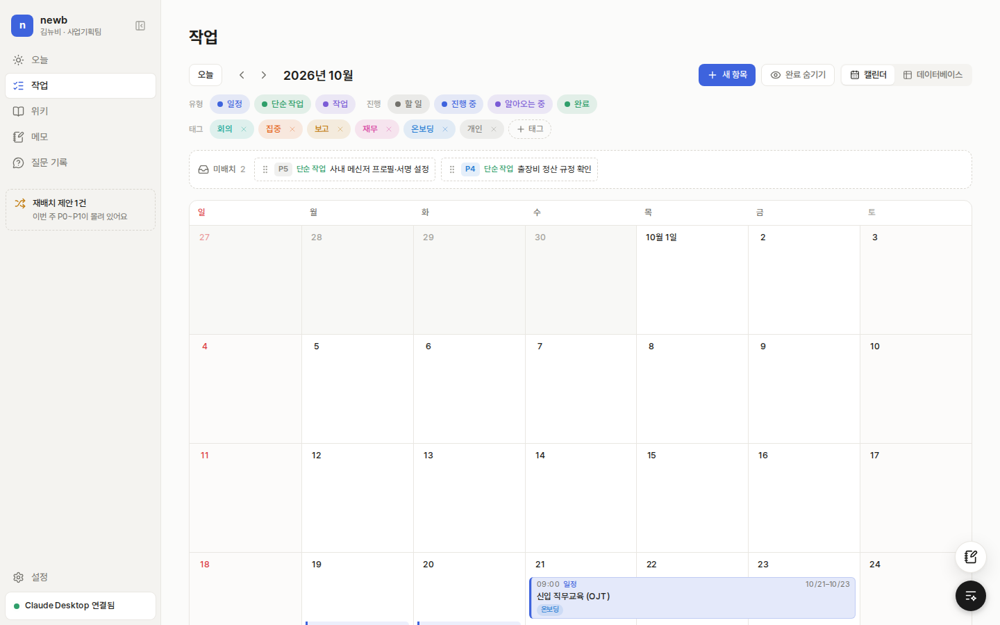
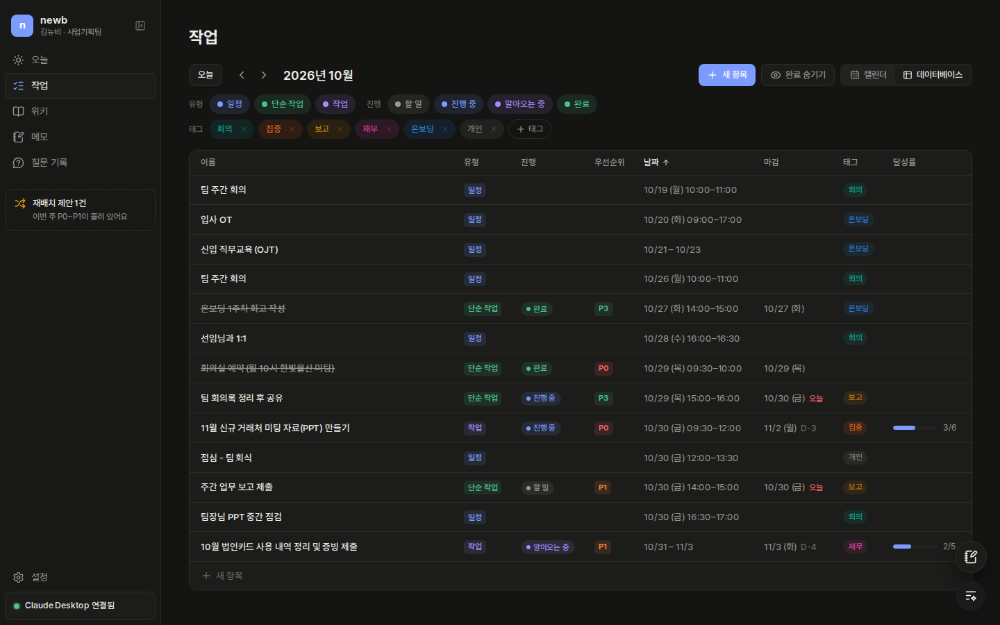
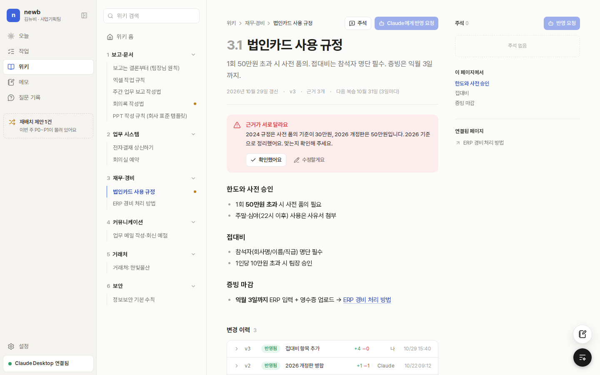
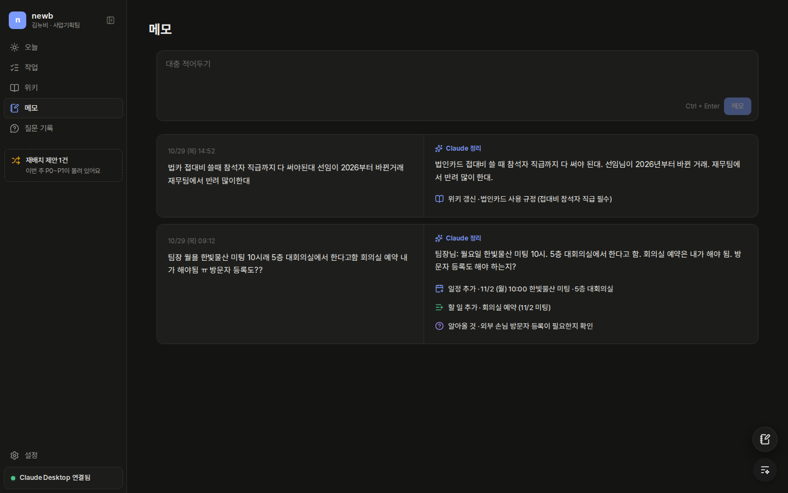

# newb

> 신입이 회사 문서·매뉴얼·조언을 쌓아 두면, 에이전트가 **"지금 확실히 답할 수 있는지"를 스스로 판단**해서
> 답하거나 **무엇을 알아와야 하는지**(상사에게 물을 것, 더 필요한 문서)를 알려주는 신입용 업무 도우미.
> 시간이 지날수록 사용자와 손발이 맞는 "같이 일하는 사람"이 되는 것이 목표입니다.



> **현재 단계: 백엔드 연결**
> 모든 화면이 MySQL·Object Storage에 저장됩니다. 메모 정리·위키 주석 반영·위키 모순 검토는 **Claude API**가 처리합니다
> (`ANTHROPIC_API_KEY`가 없으면 규칙 기반 목업). 로그인(Passkey)과 Claude Desktop 연동(MCP)은 아직입니다. → [로드맵](#로드맵)

---

## 핵심 아이디어

```
 사용자가 가져온 문서·매뉴얼·조언·빠른 메모
            │ 정리
            ▼
        ┌────────┐
        │ 위키   │  LLM이 주제별로 정리 · 변경은 주석 → Claude 반영 → 모순 검토
        └────────┘
            │ 근거 수집
            ▼
 질문 ─▶ Claude 판단 ────┬─ 확답 (출처 포함)
 (Claude Desktop)        ├─ 조건부 답 + 확인할 점
                         └─ 알아올 것 (상사에게 물을 문장, 찾을 문서)
                                   │ 알아온 답
                                   └──────────▶ 다시 위키로
```

- **채팅은 Claude Desktop에서만** 합니다. 이 앱은 MCP 서버로 위키 근거·작업 지침을 제공하고, 결과를 기록·정리하는 역할입니다.
- 확답할지·알아와야 할지는 별도 판정 모델 없이 **Claude가 직접 판단**합니다 (예전 Decision Model 계획은 2026-11-01에 뺐습니다).
- 위키 검토기·위키 편집기·메모 처리기는 인터페이스로 분리되어 있고, 운영에선 Claude 구현체(`src/server/ai/`), API 키가 없으면 규칙 기반 목업을 씁니다.

## 화면

| 메뉴 | 내용 |
|---|---|
| **오늘** (`/`) | 아침 브리핑을 겸하는 대시보드. 오늘 할 일·일정, 미리 알아두기, 알아올 것, 오늘 복습할 위키(망각 곡선 기반, "복습했음"), 이번 주 성취율, **어제 정리**(저녁 브리핑) |
| **작업** (`/tasks`) | 같은 데이터를 **캘린더 / 데이터베이스(표)** 보기로 전환, 둘 다 월별. 유형·진행 상태·태그 필터, 완료 숨기기 |
| **위키** (`/wiki`) | Next.js 문서 사이트 스타일. 본문에 **주석**을 달아 Claude에게 한 번에 반영 요청 → diff → 모순 검토 → 반영, 변경 이력 |
| **메모** (`/memos`) | 오타 섞인 러프한 메모 ↔ Claude 정리본 + 반영 내역(일정·할 일·알아올 것·위키 갱신). 화면 오른쪽 아래 **빠른 메모** 버튼 |
| **질문 기록** (`/questions`) | Claude Desktop에서 한 질문의 답(확답·조건부·알아올 것), Claude가 그렇게 답한 이유, 알아올 것(상사에게 물을 문장) |
| **재배치 제안** (`/reschedule`) | 일이 몰리면 마감·우선순위(P0~P5) 기준 재배치안, 항목별 수락 |
| **설정** (`/settings`) | 대시보드 알림, Claude Desktop(MCP) 연결, Claude API 상태, Passkey |

<table>
  <tr>
    <td></td>
    <td></td>
  </tr>
  <tr>
    <td></td>
    <td></td>
  </tr>
</table>

### 항목 모델

일정과 할 일을 **항목(Item)** 하나로 다룹니다.

| 유형 | 시간 | 완료 체크 | 하위 항목 / 달성률 | 우선순위 |
|---|---|---|---|---|
| 일정 | 시작~끝 (필수) | 없음 | 없음 | 없음 |
| 단순 작업 | 작업할 날·기간 (선택), 마감일 | 있음 | 없음 | P0~P5 |
| 작업 | 작업할 날·기간 (선택), 마감일 | 달성률 % | 있음 (1단계) | P0~P5 |

- 단순 작업 ↔ 작업은 **하위 항목 유무로 자동 전환**됩니다.
- 유형(고정 3종)과 별개로 **자유 태그**(추가·삭제·색 지정)와 **진행 상태**(할 일·진행 중·알아오는 중·완료)를 붙입니다.
- 캘린더에서 드래그로 날짜 이동, **좌/우 끝을 끌어 기간 조절**, 미배치 보관함 ↔ 날짜 배치가 됩니다.

### 화면 원칙

- 페이지 설명·안내 문구 같은 메타 텍스트는 넣지 않습니다.
- **사람 이름은 화면에 표시하지 않고 직책**(팀장님·선임님)으로만 보여줍니다. 이름·세부 출처는 서버 전용 데이터(`server-only`)로 분리해 Claude 답변에만 씁니다.
- 데스크톱은 Chrome, iPhone·iPad는 Safari 기준. 라이트/다크 모드 지원.

## 기술 스택

- **Next.js 16** (App Router, Cache Components) 단일 앱 — 백엔드는 Route Handlers / Server Actions
- React 19, TypeScript, Tailwind CSS v4, Pretendard
- @dnd-kit (캘린더 드래그), date-fns, lucide-react
- [Agentation](https://www.agentation.com/) — 화면에 주석을 달아 Claude Code로 QA (로그인 사용자만, `/api/agentation` 프록시)
- Drizzle ORM + mysql2, zod(서버 액션 입력 검증), Docker(Next.js standalone)
- 파일 저장: 운영은 OCI SDK(서버 인증, 비밀키 없음), 로컬은 AWS S3 SDK(RustFS)
- 테스트: Vitest + Testcontainers(MySQL), Playwright e2e
- 예정: Passkey(WebAuthn), MCP 서버(`/api/mcp`), oci-prod 배포(arm64 + Caddy)

## 시작하기

```bash
npm install
cp .env.example .env.local
npm run infra:up     # MySQL + S3(RustFS) + 버킷 생성 (Docker)
npm run db:migrate   # 테이블 생성
npm run dev          # http://localhost:3000
```

### 로컬 인프라 (Docker)

| 서비스 | 주소 | 운영에서 대응 |
|---|---|---|
| MySQL 26.10.0 | `127.0.0.1:23306` (newb / newb_dev) | 공용 MySQL `ken-prod` 안의 `newb` DB (TLS 필수) |
| S3 (RustFS) | API `127.0.0.1:19000`, 콘솔 `127.0.0.1:19001` | OCI Object Storage `newb-files` (OCI SDK·서버 인증) |

- `docker compose --profile app up -d --build` 하면 운영과 같은 앱 이미지까지 띄웁니다 (마이그레이션 → 앱 순서).
- 연결 확인: `curl localhost:3000/api/health` → `{"status":"ok","checks":{"db":"ok","storage":"ok"}}`
- 스키마 변경: `src/server/db/schema.ts` 수정 → `npm run db:generate` → `npm run db:migrate`
- 초기화: `docker compose down -v` (데이터까지 삭제)
- 테스트: `npm test` — 운영과 같은 MySQL 26.10.0을 Testcontainers로 띄워 저장·위키 검토·메모 처리·재배치를 검증 (Docker 필요)
- e2e: `npm run test:e2e` — 격리된 MySQL·S3와 e2e 전용 개발 서버(포트 3100, 빌드 폴더 `.next-e2e`)를 띄워 브라우저로 주요 흐름을 검증. 평소 개발 서버·DB는 건드리지 않습니다 (Docker 필요, 처음 한 번 `npx playwright install chromium`)
  - 결과: `test-results/report` (실패하면 스크린샷·trace), 서버 로그: `/tmp/newb-e2e/next-dev.log`

### 데이터 흐름

```
서버 렌더   WorkspaceGate: 로그인 확인 → DB에서 작업공간 스냅샷 → WorkspaceProvider
화면       useItems / useWiki / useMemos … (스냅샷에서 읽기)
바꾸기     화면을 먼저 바꾸고 → 서버 액션(로그인 확인 + zod 검증) → DB
           실패하면 서버 값으로 되돌리고 오류 표시
서버 처리   위키 검토·메모 처리는 응답 뒤 after()로 실행, 화면은 끝날 때까지 /api/workspace를 다시 불러옴
           서버가 재시작돼 멈춘 처리는 다음 /api/workspace 요청 때 다시 돌림 (먼저 점유해서 한 번만)
           처리기가 실패하면 메모는 '실패'(다시 정리 가능), 위키 변경은 '확인 필요'로 남김
           위키 변경은 만든 뒤 문서가 바뀌었으면 덮어쓰지 않고 '확인 필요'로 돌림
원본 파일   POST /api/sources → Object Storage + sources 테이블, GET /api/sources/{id}/file로 내려받기
```

- 로그인은 아직 임시(`src/lib/auth.ts`): `next dev`는 로그인된 상태, 운영 빌드는 항상 비로그인이라 **데이터가 하나도 나가지 않습니다** (Passkey 붙이면 교체).
- "오늘"은 한국 시간 기준이며, 서버가 스냅샷에 담아 보낸 시각으로 맞춥니다 (`src/lib/today.ts`).
- 사람 이름·내부 메모·자료 제공자는 DB에만 있고 화면으로 보내지 않습니다 (Claude 답변용).

### 운영 연결 (oci-prod)

앱 컨테이너는 아래 세 파일을 `env_file`로 읽습니다 (`anthropic.env`는 직접 만듦 — [infra/oci](infra/oci/README.md#claude-api-키-넣기)).

| 파일 | 앱이 쓰는 값 |
|---|---|
| `/srv/newb/newb.env` | `DATABASE_URL` (`…?ssl=true` → TLS 암호화. 사설 CA로 검증하려면 `DATABASE_SSL_CA_FILE` 추가) |
| `/srv/newb/object-storage.env` | `OCI_AUTH=instance_principal` `OCI_REGION` `OCI_NAMESPACE` `OCI_BUCKET` → OCI SDK로 버킷 접근 |
| `/srv/newb/anthropic.env` | `ANTHROPIC_API_KEY` (선택: `CLAUDE_MODEL`, 기본 `claude-opus-5-5`) → 메모 정리·위키 편집·모순 검토 |

- 배포: **main에 푸시하면 자동**. GitHub Actions가 검사·e2e 후 arm64 이미지를 GHCR에 올리고, oci-prod 타이머가 2분 안에 가져가 마이그레이션 → 교체 → 상태 확인(실패 시 되돌림) — [infra/oci](infra/oci/README.md#3-배포-cicd--deploy)
- 앱에는 목데이터가 없습니다. 테스트용 목데이터·시드는 `test/fixtures`에만 있고(`npm run test:seed`, e2e가 격리된 DB에 넣음), 개발·운영 DB는 빈 상태에서 시작합니다.

다른 기기(같은 Tailscale 망 등)에서 개발 서버에 접속하려면 `.env.local`에 허용할 주소를 적습니다.

```bash
# .env.local
DEV_ORIGINS=100.x.x.x,my-dev-host
```

### 화면 주석(Agentation)으로 QA하기

```bash
npm run annotations   # 주석 서버 (localhost:4747)
claude mcp add agentation -- npx -y agentation-mcp server
```

개발 서버에서 오른쪽 아래 주석 버튼으로 요소를 찍고 의견을 남기면, Claude Code가 MCP로 읽고 반영합니다.
주석 서버 주소는 `AGENTATION_URL`(기본 `http://localhost:4747`)로 바꿀 수 있습니다.

## 폴더 구조

```
src/
├─ app/                    라우트 (오늘, tasks, wiki, memos, questions, items/[id], reschedule, settings)
│  └─ api/                 workspace(스냅샷), sources(원본 업로드·내려받기), health, agentation 프록시, auth/me
├─ components/
│  ├─ calendar/            작업 화면 — 월 그리드, 데이터베이스 표, 필터 바, 상세 패널
│  ├─ dashboard/           오늘 대시보드
│  ├─ item/                항목 상세·편집 필드·새 항목·Claude 작업 지침
│  ├─ wiki/                문서 내비게이션, 본문·주석·diff·변경 이력, 위키 스토어
│  ├─ memo/                메모 탭, 빠른 메모 버튼, 메모 스토어
│  ├─ workspace/           작업공간 스토어(낙관적 업데이트·다시 불러오기), Provider, 로그인 확인 Gate
│  └─ …                    질문 기록, 재배치, 설정, 공통 UI
├─ lib/
│  ├─ types.ts             도메인 타입 (Item, WikiPage, QuestionRecord …)
│  ├─ items.ts · itemStore.ts   항목 헬퍼 · 클라이언트 스토어
│  ├─ wikiReview.ts        위키 모순 검토기 인터페이스 (WikiReviewer) + 규칙 목업
│  ├─ wikiEditor.ts        주석 → 문서 수정 인터페이스 (WikiEditor) + 패턴 목업
│  ├─ memoProcessor.ts     메모 처리기 인터페이스 (MemoProcessor) + 규칙 목업
│  └─ diff.ts              줄 단위 diff
├─ server/                 서버 전용 (server-only)
│  ├─ ai/                  Claude API 구현체 — 메모 정리·위키 편집·모순 검토 (구조화 출력)
│  ├─ db/                  Drizzle 스키마 · MySQL 연결 · 값 변환
│  ├─ services/            도메인 로직 (항목·위키·메모·질문·재배치·원본·작업공간) — 테스트 대상
│  ├─ actions.ts           서버 액션 (로그인 확인 → 검증 → 서비스)
│  ├─ validation.ts        입력 검증 (zod)
│  └─ storage*.ts          Object Storage — OCI SDK(운영) / S3(로컬)
drizzle/                   DB 마이그레이션 SQL
scripts/                   마이그레이션 실행기
test/                      통합 테스트 (Testcontainers MySQL)
└─ fixtures/               테스트 전용 목데이터·시드 (앱 코드는 쓰지 않음)
e2e/                       브라우저 e2e (Playwright) — global-setup이 격리된 DB·S3·개발 서버를 띄움
compose.yaml · Dockerfile  로컬 인프라 · 앱 이미지
docs/PLAN.md               기획·결정 기록
```

## 로드맵

- [x] 웹 프론트 목업 (대시보드, 작업, 위키, 메모, 질문 기록, 재배치, 설정)
- [x] QA 반영: 항목 통합 모델, 캘린더/데이터베이스 보기, 위키 주석 반영 흐름, 빠른 메모
- [x] 인프라: 로컬 Docker(MySQL·S3), Drizzle 마이그레이션, 앱 이미지
- [x] 백엔드: MySQL 스키마, 서버 액션·Route Handlers, 서버 저장, 원본 업로드(Object Storage)
- [ ] Passkey 로그인 (1인용)
- [ ] MCP 서버 + Claude Desktop 커스텀 커넥터 (`ask_newb`, `get_task_brief`, `get_guidelines`, `add_to_wiki`)
- [x] 메모 처리기·위키 편집기·위키 검토기를 Claude API로 교체 (별도 판정 모델은 빼고 Claude가 직접 판단)
- [ ] iPhone·iPad Safari 최적화, PWA·푸시 알림
- [x] CI/CD: GitHub Actions(검사·e2e·arm64 이미지) → oci-prod 자동 배포 (서버 내부 `127.0.0.1:18090`)
- [x] `newb.maekr.cloud` DNS 레코드 (Cloudflare, DNS only → oci-prod)
- [ ] 외부 공개: ken-blog Caddy에 사이트 블록 (Passkey 뒤)

자세한 기획과 결정 사항은 [docs/PLAN.md](docs/PLAN.md)에 있습니다.
